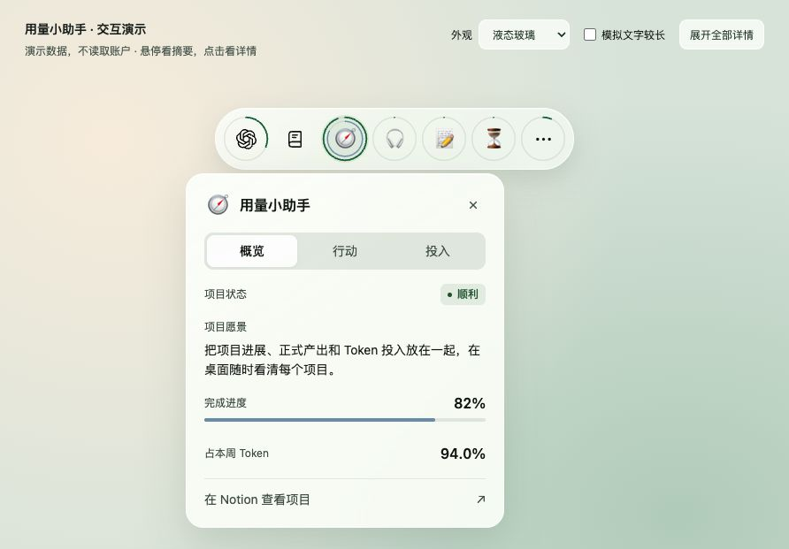

# 用量小助手 · Codex Usage Helper

**在桌面看项目进展，在 Markdown / Obsidian 管理项目，把 Codex 的 Token 投入记清楚。**

用量小助手包含跨平台本地日志扫描器、macOS 桌面胶囊和 Markdown 项目管理工具。项目愿景、当前事项、人工确认、成果引用和关键历史保存在已有 Obsidian 管理库；胶囊读取这些资料，并关联本机 Token 投入。正常运行无需 Notion 账号、Token、钥匙串或云端接口。

当前只支持 **Codex**。本项目与 OpenAI、Obsidian 均无官方隶属关系。

> Token 统计覆盖本机仍保留的会话记录，不代表完整账户用量、订阅剩余额度或最终账单。官方额度、Token 数量和估算金额采用不同口径，不能互相倒推。



## 功能

- **本地 Token 账本**：按项目、会话、模型、日期汇总；支持 JSON 导出、归档日志、压缩日志和 Git worktree。
- **桌面项目看板**：胶囊只显示图标，圆圈内悬停看摘要、点击看详情，圆圈外的胶囊背景可以拖动。普通窗口可以盖住组件。
- **统一的详情排版**：12／14／16 三档字号，指标按行排列，长内容分页，不出现卡内滚动条。
- **三种主题、两种胶囊位置**：液态玻璃、Pulse 暗色、经典白色；顶部横条与右侧竖条可独立开关，也可同时开启。
- **本地项目管理**：复用 Markdown 项目卡、任务、历史、正式反馈与成果引用，Obsidian 与胶囊读取同一份资料。
- **AI 协助维护**：沿用现有 Obsidian 项目管理 Skill、规则和模板；按固定项目 ID 维护，不靠项目名称重建身份。
- **周与月核算**：按上海自然周记录，用自己确认的会员续费日期划分月账期；保留计量覆盖情况和估算标记。

## 选择使用方式

| 想做什么 | 从哪里开始 | 要求 |
| --- | --- | --- |
| 只统计本机 Codex Token | [命令行扫描器](#只使用命令行扫描器) | Python 3.10+，macOS／Linux／Windows |
| 在桌面查看项目与用量 | [macOS 桌面组件](#macos-桌面组件) | macOS 15+、Python 3.10+，构建需要 macOS 26 SDK |
| 用 AI 整理项目并显示到胶囊 | [接入现有管理库](#接入现有-markdown--obsidian-管理库) | 本地 Markdown 管理库；Obsidian 用于查看笔记和看板 |

发布内容是可自行运行的源码，**没有预置作者的项目资料、绑定或用量数据**。本次合并继续使用现有中央库，不初始化新库或导入示例项目。

## 获取源码

```sh
git clone https://github.com/Cherrybooma/codex-usage-helper.git
cd codex-usage-helper
```

也可以从 [GitHub Releases](https://github.com/Cherrybooma/codex-usage-helper/releases) 下载源码 ZIP，或点击 **Code → Download ZIP**。解压后进入包含 `codex_usage.py` 的目录，后面的命令均从这个目录运行。源码包和 Git 克隆使用同一套安装方式。

先确认 Python 版本：

```sh
python3 --version
```

需要 **Python 3.10 或更新版本**。部分 Mac 的 `python3` 仍是 3.9；此时先安装新版 Python，再用实际解释器创建虚拟环境，例如 `python3.12 -m venv .venv`。虚拟环境创建后统一使用 `.venv/bin/python3`，避免运行时又切回旧版本。

## macOS 桌面组件

### 1. 构建并启动

运行系统最低为 macOS 15。源码包含 macOS 26 的 Liquid Glass API，因此**构建工具必须提供 macOS 26 SDK**；macOS 15 运行时使用毛玻璃回退。可先检查开发工具：

```sh
xcrun swiftc --version
xcrun --sdk macosx --show-sdk-version
```

在项目根目录运行：

```sh
sh setup.sh
sh widget/run.command
```

`setup.sh` 选择可用的 Python 3.10+，建立 `.venv`、安装可选依赖并编译应用，不会自动启动应用。如需指定新版 Python，可使用 `USAGE_HELPER_PYTHON=python3.12 sh setup.sh`；`sh setup.sh --help` 查看选项。也可手动执行：

```sh
python3.12 -m venv .venv  # 换成自己实际安装的 Python 3.10+ 解释器
.venv/bin/python3 -m pip install -r requirements-optional.txt
sh widget/build.sh
```

`requirements-optional.txt` 提供 zstd 解压支持和 IANA 时区数据。普通 JSONL／gzip 扫描只需要 Python 标准库；建议安装可选依赖，避免压缩日志被跳过。

应用生成在 `widget/build/用量小助手.app`，采用本机 ad-hoc 签名。**目前是源码运行方式，不是可独立分发的安装包**：请保留整个项目目录及 `.venv`，不要只把 `.app` 拖到其他目录。运行和设置入口分别是 `widget/run.command`、`widget/设置.command`。

### 2. 选择自己的项目目录

启动后，从菜单栏或组件右键菜单打开 **“项目与 Markdown 设置…”**，选择已有 Obsidian 管理库与本机项目目录。

任务目录默认 `~/Documents`，按其**第一级子文件夹**归集任务。例如选择 `~/Projects` 后：

```text
Projects/
├── 笔记工具/        一个任务，内部可以有多个子目录或仓库
├── 播客整理/        另一个任务
└── 时间管理/        另一个任务
```

选择适合自己的项目根目录，不需要照搬作者的目录结构。命令行扫描器使用工作目录和 Git 仓库归因，与桌面的文件夹归集粒度略有不同。

### 3. 使用胶囊

| 入口 | 展开后显示 |
| --- | --- |
| Codex | 周额度剩余、本周已用额度、本周 Token、估算投入 |
| 本期 Token | 本周 Token、任务数量、统计时间、模型响应次数 |
| 项目：悬停 | 项目状态、下一步行动、完成进度、本周 Token 占比 |
| 项目：点击 | 概览／行动／投入，含愿景、当前目标、人工待办、产出和用量 |

前两个入口固定。后面最多四个项目位，从已接入的 Markdown 管理项目中按真实本周 Token 降序选取；零用量项目可补足空位，每次刷新重新排序，其他项目归入“其他”。没有可用管理项目时回退为本机有用量文件夹的前四项。**导入项目不等于永久固定在前四位**。

图标外环表示项目本周 Token 占比，内环表示已维护的完成进度；未知进度只显示轨道。项目图标来自 Markdown 项目属性，不将用量当作项目完成度。

圆圈内悬停打开摘要，点击保持详情；再次点击、外部点击或 Esc 收起。标签整个区域可以点击，详情内长内容通过分页查看。圆圈外的胶囊背景与间隙按住拖动，外部透明区域不阻挡鼠标。

顶部横条、右侧竖条和三种视觉样式都从菜单选择。两种胶囊可同时开启，点击项目图标展开详情卡片。默认处于桌面层；若组件被其他窗口遮住，回到桌面即可看到。选择“退出用量小助手”才会停止后台刷新。

本机统计约每 60 秒刷新，Markdown 账本摘要在启用后约每 5 分钟独立发布；管理资料直接读取本地文件。官方额度需要本机已安装并登录官方 Codex CLI 或桌面应用；接口不可用时保持未知或显示有标记的旧缓存，不影响本地 Token 扫描。

详见 [桌面组件文档](widget/README.md)。

## 接入现有 Markdown / Obsidian 管理库

本机当前分工如下；路径可以在设置中核对：

| 内容 | 位置 |
| --- | --- |
| 唯一源码维护入口、计量数据库与发布程序 | `用量小助手/codex-usage-scanner/` |
| 人看的管理资料 | `~/Documents/项目管理obsidian/` |
| 沿用的统一规则、模板与已安装 Skill 参考资料 | `~/Documents/项目管理系统/规则/`、`模板/` |

从菜单打开“项目与 Markdown 设置…”，选择已有管理库，按项目固定 ID 绑定本机文件夹。已有项目卡直接读取，不因名称相同重建身份；无法确定的旧 Notion 对应关系保持未绑定，需核实后再连。绑定只改变项目关联，不修改 Token 计量。

项目卡保存目标、人工事项和目前要做的事；任务、反馈、历史与成果引用保存在项目子目录。成果保留真实工程路径、版本或 HTTPS 地址，原文件继续留在各自工程，不复制进管理库。Obsidian 是笔记展示工具，计量和 Markdown 读取不要求它持续运行；打开 `obsidian://` 入口需要本机安装 Obsidian。

```sh
./pm --help
./pm check
./pm overview
./pm new-project --help
./pm register-artifact --help
```

`./pm` 使用当前工程的 Python 与数据目录，默认读取中央管理库。`PROJECT_PM_VAULT` 可显式选择其他库；不设置时不创建新库。命令提供 `new-project`、`add-task`、`register-artifact`、`record-event`、`submit-feedback`、`apply-feedback`、`export` 等操作，先查看各命令帮助再使用。检查和总览不会创建项目。已有资料按固定 ID、版本和摘要核对，项目改名保留身份。

AI 管理继续使用现有 **`obsidian-project-manager`** Skill；可复用的仓库版见 [Skill 入口](skills/obsidian-project-manager/SKILL.md)。让 AI 读取中央规则及对应项目卡，再调用**当前工程的 `./pm`**；旧 Skill 若仍指向“项目管理系统”内的程序，需要将程序入口更新为当前工程，规则、模板和中央管理库继续共用。`PROJECT_PM_RULES_ROOT` 可显式指定中央规则目录。不要同时维护两份程序。Skill 按调用执行，后台不自行改变目标、批准验收或开始开发。

仓库版 Skill 不会自动覆盖已安装版本。需要安装或更新时，将 `skills/obsidian-project-manager` 复制到自己的 Codex Skill 目录；已有同名目录先检查并备份，保留个人修改。重新打开 Codex 后使用：

> 用 $obsidian-project-manager 整理当前项目，复用已有中央管理库，使用用量小助手当前工程的 pm，保留固定项目身份、人工正文与历史；核验成果入口和胶囊绑定。

### 迁移与发布原则

本次逐模块复用“项目管理系统”的 Markdown 读取、项目关联、成果入口、设置与测试。后续源码只在当前工程维护；参考目录保留规则、模板和历史实现供核对；迁移后的参考 `pm` 转发到当前工程，旧调用入口不再分叉维护。不要直接启动旧 `.app` 或旧计量脚本发布同一管理库。

当前工程原有 `widget/data` 是历史计量、来源身份和项目关联的依据，**不以副本运行数据替换**。已有 Markdown 项目保留固定 ID 和人工正文；相同固定账本键使用绝对数值更新，不重复累加。唯一账本发布入口是当前工程的 `widget/widget_backend.py --sync-markdown`。周、月和每日是同批记录的不同视图，不能再相加。

旧 Notion 集成代码、凭据读取器、同步器和项目 Skill 已移除。旧云端页面与本机迁移审计资料保留；迁移工具只核对旧项目绑定，不读取凭据或请求云端接口。详细约定见 [本地项目管理](docs/project-management.md)。

### 可选本机只读接口

胶囊直接读取 Markdown，无需先启动 HTTP 服务。确有其他本机程序需要观察数据时，可显式启动／停止只读接口：

```sh
sh 启动数据接口.command
sh 停止数据接口.command
```

默认只监听 `127.0.0.1:8766`；没有远程访问、任意文件下载或写入接口。不安装开机服务，也不自动启动 AI。

## 只使用命令行扫描器

扫描器在 Python 3.10+ 的 macOS、Linux、Windows 上运行，不需要 Swift、桌面应用或项目管理库。

```sh
# 查看参数；最近滚动 7 天按项目汇总
python3 codex_usage.py --help
python3 codex_usage.py

# 分别按会话、模型、日期查看
python3 codex_usage.py --group-by session
python3 codex_usage.py --group-by model
python3 codex_usage.py --group-by day --timezone Asia/Shanghai

# JSON 包含完整的项目、会话、模型、每日汇总与覆盖情况
python3 codex_usage.py --format json --output report.json

# 全部保留历史
python3 codex_usage.py --all-time

# 固定窗口：起点包含，终点不包含
python3 codex_usage.py --since 2026-01-01 --until 2026-01-08 --timezone Asia/Shanghai

# 同一 Git 仓库的 worktree 分开显示
python3 codex_usage.py --separate-worktrees
```

Windows 可将 `python3` 替换成已安装的 `py -3`。如使用虚拟环境，使用其实际 Python 路径。可选解压和时区依赖使用 `requirements-optional.txt` 安装。

macOS／Linux 也可运行 `sh setup.sh --cli-only` 只建立扫描环境，然后使用 `.venv/bin/python3 codex_usage.py`；不构建桌面应用。

数据位置优先使用 `CODEX_HOME`，否则为 `~/.codex`；只扫描其中的 `sessions` 和 `archived_sessions`。也可以传 `--codex-home /path/to/your/.codex`。支持 `.jsonl`、`.jsonl.gz`、`.jsonl.zst`；缺少 zstd 解压能力会报告跳过，不能当作零用量。

## 统计口径

| 数据 | 规则 |
| --- | --- |
| 新版日志 | 累计单次 `token_usage_record.usage`，按 `response_id` 去重；不把累计快照再相加 |
| 旧版日志 | `token_count` 累计差分；窗口前历史用于建立基线，结果标为估算 |
| Token 总数 | 优先使用原记录 `total_tokens`；缓存输入、缓存写入、推理输出是细分项，不再次加入总数 |
| 项目与模型 | 使用请求当时已出现的目录和模型上下文，不拿后续上下文倒填 |
| 日期 | 记录内部时间，不使用目录日期；未知时间与无法读取记录单独报告 |
| 桌面“本周” | 上海时区周一 00:00 至下周一 00:00，统计到实际刷新终点 |
| 命令行默认 | 最近滚动 7×24 小时，和桌面自然周不同 |
| 会员月 | 按自己确认的续费日期／时间逐月划分，不能把一个月简单当作四周 |

同仓库 worktree 默认合并。归档副本、重复响应、fork 继承、历史重写和新旧格式混合有去重／基线处理；无法确认的旧历史保持估算或跳过并警告。`coverage`、`warnings` 用于区分“没有用量”和“没有完整识别记录”。

胶囊显示前四项目和“其他”只改变呈现，不改变总量。本周任务数是**全部有用量文件夹**的数量，不是可见图标数；占比以全部本机已记录 Token 为分母。

具体处理与边界见 [统计说明](docs/statistics.md)。

## 官方额度与金额估算

官方额度来自本机官方 Codex 客户端的 `account/rateLimits/read`，认证由官方客户端处理。本项目不直接读取认证文件，也不向该接口发送日志、项目路径或统计报告。

- **周额度剩余**：`100 − 官方当前周窗口已用百分比`。
- **本周已用额度**：本机在上海自然周内保存的使用增量累计，和官方窗口可能不是同一周期。
- **提前重置**：保留重置前已观测使用量，再累计新窗口使用量；重置本身不会凭空增加 100%。

例如先观测到用了 80%，重置后再观测到用了 70%，本周已记录使用约 150%，其中超出一份正常额度的部分约 50%。首次观测、采集中断、重置前缺读数、容量或套餐变化都可能造成缺口或歧义。“未超额”只表示已记录部分未超过 100%，不能证明完整账户消费未超额；下限使用 `≥`，无法判断时保持未知。

**估算投入采用人为参考基准：周额度 100% = $5。**

```text
整周估算 = $5 × 本周累计已用百分比 ÷ 100
项目估算 = 整周估算 × 项目本周 Token ÷ 全部本周 Token
```

例如累计 140% 对应约 $7；某项目占 50% 对应约 $3.50。这是订阅投入的估算分摊，**不是官方 Token 单价、真实扣款、API 账单或超额收费**。不能从 Token 数倒推出剩余官方额度，也不假设订阅每周固定包含多少 Token。

周期核算菜单可填写自己的续费锚点。未知时月账期保持待配置；只知道日期时使用上海时间当天 00:00，标为日期精度估算。周、月重新分组同一批计量事件，不能再相加。周／月摘要可发布到中央库的账本目录；高频观测继续保存在本机数据库，按需才导出额度窗口。见 [周期核算说明](docs/period-proposal.md)。

## 数据与隐私

- 日志扫描在本机执行，不修改 Codex 会话，不直接读取 `auth.json` 或认证环境变量。
- 报告不包含提示词、代码、回复或工具输出，但可能包含私人目录、会话 ID；请自行检查后再分享。
- 项目管理与可读账本在本机 Markdown 文件中维护；不上传原始日志、源码、对话或密钥。成果引用可包含私人本机路径，分享笔记前自行检查。
- `widget/data/` 保存本机缓存、项目身份、绑定、额度历史与设置；`.venv/`、构建产物、`validation/` 和本地密钥文件均被 Git 忽略，不属于公开源码。
- 重复扫描以绝对摘要替换原数值，不把多次扫描相加；多设备重复日志合并尚未支持。

分享源码时不要把自己的 `widget/data`、真实报告、Codex 目录或密钥一起打包。删除本机数据会丢失绑定、累计观测与匿名来源身份；备份后再操作，避免重新发布产生另一套来源摘要。

## 演示与开发检查

[HTML 排版与交互演示](widget/preview/layout-review.html)使用固定演示数据，不连接账户。GitHub 上的链接显示源码；下载后可直接用浏览器打开文件，或从仓库根目录启动本地预览：

```sh
.venv/bin/python3 -m http.server 8347 --bind 127.0.0.1 --directory widget/preview
```

访问 `http://127.0.0.1:8347/layout-review.html`，按 Ctrl+C 停止服务。它是样式与交互演示，不代替原生应用，也不能作为真实用量验证。

Python 检查使用临时模拟日志、临时 Git 仓库和隔离 API 模拟服务，不读取真实用户会话：

```sh
.venv/bin/python3 -m unittest -v test_codex_usage.py widget/test_widget_backend.py \
  widget/test_project_store.py widget/test_markdown_store.py widget/test_management_workflow.py \
  widget/test_markdown_migration.py widget/test_publication_identity.py \
  widget/test_period_accounting.py widget/test_period_backend.py \
  widget/test_quota_accounting.py widget/test_project_import.py
```

Swift 数据与交互检查（需要上述开发工具）：

```sh
mkdir -p widget/build/module-cache
xcrun swiftc -parse-as-library -swift-version 5 -D WIDGET_CHECKS \
  widget/UsageWidget.swift widget/UsageStrip.swift widget/ProjectSettings.swift widget/test_strip.swift \
  -o widget/build/strip-checks -framework AppKit -framework SwiftUI \
  -module-cache-path widget/build/module-cache
widget/build/strip-checks

xcrun swiftc -parse-as-library -swift-version 5 -D WIDGET_CHECKS \
  widget/UsageWidget.swift widget/UsageStrip.swift widget/ProjectSettings.swift widget/test_period_settings.swift \
  -o widget/build/period-settings-checks -framework AppKit -framework SwiftUI \
  -module-cache-path widget/build/module-cache
widget/build/period-settings-checks
```

HTML 事件路径回归检查需要 Node.js：

```sh
node widget/test_preview_events.cjs
```

测试通过只说明这些用例覆盖的行为，不能替代自己机器上的真实日志、项目绑定和成果入口验证。

如需自行制作源码包，在 Git 检出目录提交所需改动后运行：

```sh
sh scripts/package-source.sh HEAD
```

输出位于 `dist/`。脚本只归档指定提交和允许发布的文件，不包含未提交编辑、本机数据、虚拟环境或编译产物；GitHub 下载的纯源码 ZIP 没有 `.git`，不用于再次运行这个打包命令。

## 项目目录与详细说明

```text
codex_usage.py                 跨平台日志扫描器
test_codex_usage.py            扫描器测试
widget/UsageWidget.swift       macOS 应用生命周期与共享数据模型
widget/UsageStrip.swift        胶囊、详情卡与交互
widget/ProjectSettings.swift   原生 Markdown、项目与周期设置
widget/widget_backend.py       本周归集、官方额度与同步入口
widget/project_import.py       项目清单验证、导入与绑定
widget/markdown_store.py       Markdown 读取、固定身份绑定与账本投影
widget/project_manager.py      AI 项目管理命令
widget/management_api.py       可选本机只读观察接口
widget/project_store.py        稳定项目身份与每日事实
widget/period_accounting.py    自然周与会员月的事件核算
widget/quota_accounting.py     额度观测与质量判断
pm                            当前工程的项目管理入口
```

- [桌面组件文档](widget/README.md)
- [完整统计口径](docs/statistics.md)
- [项目管理结构](docs/project-management.md)
- [Markdown 项目管理 Skill](skills/obsidian-project-manager/SKILL.md)
- [周期核算规则](docs/period-proposal.md)
- [第三方资产说明](THIRD_PARTY_NOTICES.md)

## 许可

本项目采用 [MIT License](LICENSE)。第三方资产保留原许可，见 [THIRD_PARTY_NOTICES.md](THIRD_PARTY_NOTICES.md)。OpenAI 名称与标识仅用于识别 Codex 服务，不表示官方合作或背书。

## 当前限制

只支持 Codex；不能恢复删除的日志，也不覆盖其他设备、其他系统用户或云端任务的完整消费。日志格式和官方接口变化可能需要适配；旧累计格式始终有估算边界。

桌面组件目前以本地构建运行，尚未提供签名公证的独立安装包。macOS 26 的原生玻璃效果、多屏切换和所有桌面鼠标场景仍需要更多实机验证。项目管理 Skill 按调用执行，没有默认持续运行的 AI 项目经理。Markdown 的固定属性子集、成果引用和有限只读 API 均有边界，见管理说明。
