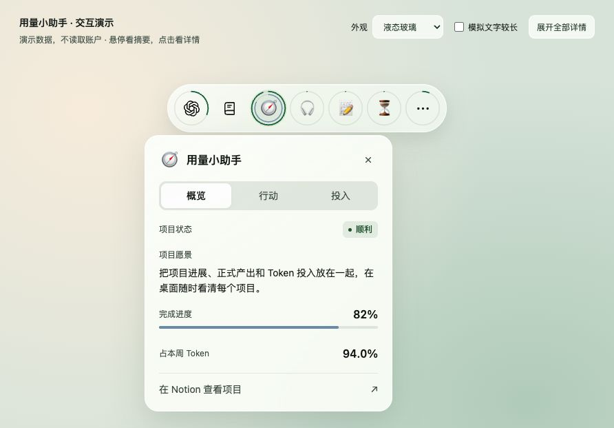

# 用量小助手 · Codex Usage Helper

**在桌面看项目进展，在 Notion 管理项目，把 Codex 的 Token 投入记清楚。**

用量小助手由三部分组成：跨平台的本地日志扫描器、macOS 桌面胶囊，以及可安装到 Codex 的 Notion 项目管理 Skill。可以只在本机看用量，也可以连接自己的 Notion，让项目愿景、当前目标、人工待办、正式产出和 Token 账本放在一起。

当前只支持 **Codex**。本项目与 OpenAI、Notion 均无官方隶属关系。

> Token 统计覆盖本机仍保留的会话记录，不代表完整账户用量、订阅剩余额度或最终账单。官方额度、Token 数量和估算金额采用不同口径，不能互相倒推。



## 功能

- **本地 Token 账本**：按项目、会话、模型、日期汇总；支持 JSON 导出、归档日志、压缩日志和 Git worktree。
- **桌面项目看板**：胶囊只显示图标，圆圈内悬停看摘要、点击看详情，圆圈外的胶囊背景可以拖动。普通窗口可以盖住组件。
- **统一的详情排版**：12／14／16 三档字号，指标按行排列，长内容分页，不出现卡内滚动条。
- **三种主题和展示位置**：液态玻璃、Pulse 暗色、经典白色；顶部横条、右侧竖条、桌面小框可独立开关。
- **Notion 项目管理**：愿景、人工确认事项、当前进展与下一步、开发历史、Token 投入；阶段进展关联正式产出。
- **已有项目导入 Skill**：从实际文档和成果整理项目，复用已有工作台，绑定本机文件夹与胶囊。
- **周与月核算**：按上海自然周记录，用自己确认的会员续费日期划分月账期；保留计量覆盖情况和估算标记。

## 选择使用方式

| 想做什么 | 从哪里开始 | 要求 |
| --- | --- | --- |
| 只统计本机 Codex Token | [命令行扫描器](#只使用命令行扫描器) | Python 3.10+，macOS／Linux／Windows |
| 在桌面查看项目与用量 | [macOS 桌面组件](#macos-桌面组件) | macOS 15+、Python 3.10+，构建需要 macOS 26 SDK |
| 用 AI 整理项目并接入 Notion | [Notion 连接](#连接自己的-notion可选)和 [Skill 安装](#安装-skill并用于其他项目) | 自己的 Notion 工作区、连接权限和 Codex |

发布内容是可自行运行的源码，**没有预置作者的 Notion、凭据、项目绑定和用量数据**。下载后使用自己的本机记录和工作区。

## 获取源码

```sh
git clone https://github.com/Cherrybooma/codex-usage-helper.git
cd codex-usage-helper
```

也可以从 [GitHub Releases](https://github.com/Cherrybooma/codex-usage-helper/releases) 下载源码 ZIP，或点击 **Code → Download ZIP**。解压后进入包含 `codex_usage.py` 的目录，后面的命令均从这个目录运行。源码包和 Git 克隆使用同一套安装方式。

先确认 Python 版本：

```sh
python3 --version
```

需要 **Python 3.10 或更新版本**。部分 Mac 的 `python3` 仍是 3.9；此时先安装新版 Python，再用实际解释器创建虚拟环境，例如 `python3.12 -m venv .venv`。虚拟环境创建后统一使用 `.venv/bin/python3`，避免运行时又切回旧版本。

## macOS 桌面组件

### 1. 构建并启动

运行系统最低为 macOS 15。源码包含 macOS 26 的 Liquid Glass API，因此**构建工具必须提供 macOS 26 SDK**；macOS 15 运行时使用毛玻璃回退。可先检查开发工具：

```sh
xcrun swiftc --version
xcrun --sdk macosx --show-sdk-version
```

在项目根目录运行：

```sh
sh setup.sh
sh widget/run.command
```

`setup.sh` 选择可用的 Python 3.10+，建立 `.venv`、安装可选依赖并编译应用，不会自动启动应用。如需指定新版 Python，可使用 `USAGE_HELPER_PYTHON=python3.12 sh setup.sh`；`sh setup.sh --help` 查看选项。也可手动执行：

```sh
python3.12 -m venv .venv  # 换成自己实际安装的 Python 3.10+ 解释器
.venv/bin/python3 -m pip install -r requirements-optional.txt
sh widget/build.sh
```

`requirements-optional.txt` 提供 zstd 解压支持和 IANA 时区数据。普通 JSONL／gzip 扫描只需要 Python 标准库；建议安装可选依赖，避免压缩日志被跳过。

应用生成在 `widget/build/用量小助手.app`，采用本机 ad-hoc 签名。**目前是源码运行方式，不是可独立分发的安装包**：请保留整个项目目录及 `.venv`，不要只把 `.app` 拖到其他目录。运行和设置入口分别是 `widget/run.command`、`widget/设置.command`。

### 2. 选择自己的项目目录

启动后，从菜单栏或组件右键菜单打开 **“项目与 Notion 设置…”**。默认本机模式，无需 Notion Token。

任务目录默认 `~/Documents`，按其**第一级子文件夹**归集任务。例如选择 `~/Projects` 后：

```text
Projects/
├── 笔记工具/        一个任务，内部可以有多个子目录或仓库
├── 播客整理/        另一个任务
└── 时间管理/        另一个任务
```

选择适合自己的项目根目录，不需要照搬作者的目录结构。命令行扫描器使用工作目录和 Git 仓库归因，与桌面的文件夹归集粒度略有不同。

### 3. 使用胶囊

| 入口 | 展开后显示 |
| --- | --- |
| Codex | 周额度剩余、本周已用额度、本周 Token、估算投入 |
| 本期 Token | 本周 Token、任务数量、统计时间、模型响应次数 |
| 项目：悬停 | 项目状态、下一步行动、完成进度、本周 Token 占比 |
| 项目：点击 | 概览／行动／投入，含愿景、当前目标、人工待办、产出和用量 |

前两个入口固定。后面最多四个项目位，从已接入的 Notion 管理项目中按真实本周 Token 降序选取；零用量项目可补足空位，每次刷新重新排序，其他项目归入“其他”。没有可用管理项目时回退为本机有用量文件夹的前四项。**导入项目不等于永久固定在前四位**。

图标外环表示项目本周 Token 占比，内环表示已维护的完成进度；未知进度只显示轨道。项目图标来自 Notion 页面 icon，不将用量当作项目完成度。

圆圈内悬停打开摘要，点击保持详情；再次点击、外部点击或 Esc 收起。标签整个区域可以点击，详情内长内容通过分页查看。圆圈外的胶囊背景与间隙按住拖动，外部透明区域不阻挡鼠标。

顶部横条、右侧竖条、桌面小框和三种视觉样式都从菜单选择。默认处于桌面层；若组件被其他窗口遮住，回到桌面即可看到。选择“退出用量小助手”才会停止后台刷新。

本机统计约每 60 秒刷新，Notion 同步在启用后约每 5 分钟独立运行。官方额度需要本机已安装并登录官方 Codex CLI 或桌面应用；接口不可用时保持未知或显示有标记的旧缓存，不影响本地 Token 扫描。

详见 [桌面组件文档](widget/README.md)。

## 连接自己的 Notion（可选）

1. 在自己的 Notion 工作区准备一个父页面，并创建可读取、插入、更新内容的内部连接。
2. 将父页面共享给该连接。
3. 打开 **“项目与 Notion 设置…”**，开启 Notion 同步，填入连接 Token 与父页面链接，再初始化项目工作台。
4. 为项目设置 emoji 或 HTTPS Logo；选择“绑定已有项目”，或使用下面的 Skill 导入一个项目。

凭据默认保存在本机 macOS Keychain 的专用项。也可在设置中明确选择自己的 Pages 密钥文件作为来源；不会搜索其他文件，不上传整个文件，也不保存明文 Token 副本。**不要把 Token 发到聊天、写入项目清单或提交到 GitHub。**

Notion 工作台包含五部分：项目愿景、待人工确认、当前进展与下一步、历史开发记录、Token 投入。当前进展需要关联可核查的正式产出。AI 负责在你调用 Skill 时整理和维护；桌面后台只读取管理状态与同步已计量摘要，**不会持续读代码、自行判断完成情况或自动改写项目目标**。

双向数据流为：

```text
Notion 项目状态、目标、图标、进度、人工事项 → 本机胶囊
本机已计量的项目每日 Token 摘要             → Notion 账本
```

关闭 Notion 同步后，本地扫描继续；已有工作台不会被删除。日常同步只处理变化摘要，额度高频观测留在本机，不为每次刷新新建一页。详细字段、重试和周期配置见 [Notion 说明](docs/notion.md)、[项目管理说明](docs/project-management.md)。

## 安装 Skill，并用于其他项目

仓库包含可复用的 **`notion-project-workbench`** Skill。它不是克隆仓库后自动安装，需要复制到自己的 Codex Skill 目录。

在本仓库根目录执行：

```sh
TASK_SKILLS_DIR="${CODEX_HOME:-$HOME/.codex}/skills"
mkdir -p "$TASK_SKILLS_DIR"
if [ -e "$TASK_SKILLS_DIR/notion-project-workbench" ]; then
  printf '%s\n' '已有同名 Skill：请先备份并移走旧目录，再运行复制命令。'
else
  cp -R skills/notion-project-workbench "$TASK_SKILLS_DIR/"
fi
```

如果目标位置已有自己修改过的同名 Skill，先备份，再复制新版。复制后重新打开 Codex 项目或重启客户端，使其发现新技能。

然后在任意**要管理的项目**里打开 Codex，直接说：

> 用 $notion-project-workbench 整理当前项目。先检查 Notion 是否已有工作台，有则复用并更新，没有再创建；保留已有人工内容和历史。根据实际文档和产出整理愿景、当前目标、下一步、人工事项、重要历史和 Token 投入，并绑定用量小助手。用量小助手源码位于我指定的安装目录。

首次调用时告诉它用量小助手的实际源码目录；本机导入需要使用同一份 `widget/data`，以复用应用的连接与绑定。不要把其他项目的当前目录误当成扫描器目录。

Skill 会先核查项目事实，生成 `project-import.json` 并验证产出；已有管理主页就在其中复用／创建项目，没有时在已授权父页面下建立“项目管理”。也可在原生设置的 **“一键导入已有项目”**中选择清单与项目文件夹执行。

### 已有工作台会重复创建吗？

| 情况 | 行为 |
| --- | --- |
| 本机文件夹已经绑定 Notion 页面 | 复用原页面，维护当前状态、目标、进度和正式产出 |
| Notion 已有项目，但尚未绑定 | 先核对已有页面身份并建立绑定，再更新 |
| 确实不存在该项目 | 新建工作台并绑定 |

**不会凭项目同名自动认领页面。** 已有工作台位于其他数据库，或尚未绑定时，需要先确认目标页面；跳过这一步直接创建仍可能造成重复。程序依靠稳定的本机文件夹身份和 Notion 页面 ID，不能仅凭名称保证全局去重。

已有正文、人工内容、原生视图和历史保留；当前管理信息按本次核实结果更新。开发历史追加事件，已完成任务不删除。相同清单重试会复用稳定键；Notion 没有数据库唯一约束，创建结果不确定或发现重复键时暂停确认，不能宣称并发操作绝不会重复。

Skill 调用本身需要可写的 Notion 授权。本机后台连接与聊天里的 Notion 连接器相互独立，连接器授权不能直接交给桌面进程。只完成 Notion 写入、没有本机绑定，不算胶囊已接入。导入项目也不改变任何真实 Token 总数。

可复制的格式示例见 [project-import.json](examples/project-import.json)，请先替换为真实项目事实。完整流程和 `--dry-run` 验证方式见 [Skill](skills/notion-project-workbench/SKILL.md)及[导入说明](skills/notion-project-workbench/references/import.md)。

## 只使用命令行扫描器

扫描器在 Python 3.10+ 的 macOS、Linux、Windows 上运行，不需要 Swift、桌面应用或 Notion。

```sh
# 查看参数；最近滚动 7 天按项目汇总
python3 codex_usage.py --help
python3 codex_usage.py

# 分别按会话、模型、日期查看
python3 codex_usage.py --group-by session
python3 codex_usage.py --group-by model
python3 codex_usage.py --group-by day --timezone Asia/Shanghai

# JSON 包含完整的项目、会话、模型、每日汇总与覆盖情况
python3 codex_usage.py --format json --output report.json

# 全部保留历史
python3 codex_usage.py --all-time

# 固定窗口：起点包含，终点不包含
python3 codex_usage.py --since 2026-01-01 --until 2026-01-08 --timezone Asia/Shanghai

# 同一 Git 仓库的 worktree 分开显示
python3 codex_usage.py --separate-worktrees
```

Windows 可将 `python3` 替换成已安装的 `py -3`。如使用虚拟环境，使用其实际 Python 路径。可选解压和时区依赖使用 `requirements-optional.txt` 安装。

macOS／Linux 也可运行 `sh setup.sh --cli-only` 只建立扫描环境，然后使用 `.venv/bin/python3 codex_usage.py`；不构建桌面应用。

数据位置优先使用 `CODEX_HOME`，否则为 `~/.codex`；只扫描其中的 `sessions` 和 `archived_sessions`。也可以传 `--codex-home /path/to/your/.codex`。支持 `.jsonl`、`.jsonl.gz`、`.jsonl.zst`；缺少 zstd 解压能力会报告跳过，不能当作零用量。

## 统计口径

| 数据 | 规则 |
| --- | --- |
| 新版日志 | 累计单次 `token_usage_record.usage`，按 `response_id` 去重；不把累计快照再相加 |
| 旧版日志 | `token_count` 累计差分；窗口前历史用于建立基线，结果标为估算 |
| Token 总数 | 优先使用原记录 `total_tokens`；缓存输入、缓存写入、推理输出是细分项，不再次加入总数 |
| 项目与模型 | 使用请求当时已出现的目录和模型上下文，不拿后续上下文倒填 |
| 日期 | 记录内部时间，不使用目录日期；未知时间与无法读取记录单独报告 |
| 桌面“本周” | 上海时区周一 00:00 至下周一 00:00，统计到实际刷新终点 |
| 命令行默认 | 最近滚动 7×24 小时，和桌面自然周不同 |
| 会员月 | 按自己确认的续费日期／时间逐月划分，不能把一个月简单当作四周 |

同仓库 worktree 默认合并。归档副本、重复响应、fork 继承、历史重写和新旧格式混合有去重／基线处理；无法确认的旧历史保持估算或跳过并警告。`coverage`、`warnings` 用于区分“没有用量”和“没有完整识别记录”。

胶囊显示前四项目和“其他”只改变呈现，不改变总量。本周任务数是**全部有用量文件夹**的数量，不是可见图标数；占比以全部本机已记录 Token 为分母。桌面小框仍保留“低于 5% 合并到其他”的分组。

具体处理与边界见 [统计说明](docs/statistics.md)。

## 官方额度与金额估算

官方额度来自本机官方 Codex 客户端的 `account/rateLimits/read`，认证由官方客户端处理。本项目不直接读取认证文件，也不向该接口发送日志、项目路径或统计报告。

- **周额度剩余**：`100 − 官方当前周窗口已用百分比`。
- **本周已用额度**：本机在上海自然周内保存的使用增量累计，和官方窗口可能不是同一周期。
- **提前重置**：保留重置前已观测使用量，再累计新窗口使用量；重置本身不会凭空增加 100%。

例如先观测到用了 80%，重置后再观测到用了 70%，本周已记录使用约 150%，其中超出一份正常额度的部分约 50%。首次观测、采集中断、重置前缺读数、容量或套餐变化都可能造成缺口或歧义。“未超额”只表示已记录部分未超过 100%，不能证明完整账户消费未超额；下限使用 `≥`，无法判断时保持未知。

**估算投入采用人为参考基准：周额度 100% = $5。**

```text
整周估算 = $5 × 本周累计已用百分比 ÷ 100
项目估算 = 整周估算 × 项目本周 Token ÷ 全部本周 Token
```

例如累计 140% 对应约 $7；某项目占 50% 对应约 $3.50。这是订阅投入的估算分摊，**不是官方 Token 单价、真实扣款、API 账单或超额收费**。不能从 Token 数倒推出剩余官方额度，也不假设订阅每周固定包含多少 Token。

周期核算菜单可填写自己的续费锚点。未知时月账期保持待配置；只知道日期时使用上海时间当天 00:00，标为日期精度估算。周、月重新分组同一批计量事件，不能再相加。已配置的 Notion 周／月账本可同步摘要；不会因导入项目自动新增独立额度页面。见 [周期核算说明](docs/period-proposal.md)。

## 数据与隐私

- 日志扫描在本机执行，不修改 Codex 会话，不直接读取 `auth.json` 或认证环境变量。
- 报告不包含提示词、代码、回复或工具输出，但可能包含私人目录、会话 ID；请自行检查后再分享。
- Notion 仅同步已授权的项目管理信息、绑定项目的每日用量摘要，以及已配置周期账本的计数与简短项目／模型汇总；不上传原始日志、源码、绝对本机路径、会话／响应 ID 或密钥。
- `widget/data/` 保存本机缓存、项目身份、绑定、额度历史与设置；`.venv/`、构建产物、`validation/` 和本地密钥文件均被 Git 忽略，不属于公开源码。
- 重复扫描以绝对摘要替换原数值，不把多次扫描相加；多设备重复日志合并尚未支持。

分享源码时不要把自己的 `widget/data`、真实报告、Codex 目录或密钥一起打包。删除本机数据会丢失绑定、累计观测与匿名来源身份；备份后再操作，避免重新同步产生另一套来源摘要。

## 演示与开发检查

[HTML 排版与交互演示](widget/preview/layout-review.html)使用固定演示数据，不连接账户。GitHub 上的链接显示源码；下载后可直接用浏览器打开文件，或从仓库根目录启动本地预览：

```sh
.venv/bin/python3 -m http.server 8347 --bind 127.0.0.1 --directory widget/preview
```

访问 `http://127.0.0.1:8347/layout-review.html`，按 Ctrl+C 停止服务。它是样式与交互演示，不代替原生应用，也不能作为真实用量验证。

Python 检查使用临时模拟日志、临时 Git 仓库和隔离 API 模拟服务，不读取真实用户会话：

```sh
.venv/bin/python3 -m unittest -v test_codex_usage.py widget/test_widget_backend.py \
  widget/test_project_store.py widget/test_notion_sync.py widget/test_notion_credentials.py \
  widget/test_period_accounting.py widget/test_period_backend.py \
  widget/test_quota_accounting.py widget/test_period_notion.py widget/test_project_import.py
```

Swift 数据与交互检查（需要上述开发工具）：

```sh
mkdir -p widget/build/module-cache
xcrun swiftc -parse-as-library -swift-version 5 -D WIDGET_CHECKS \
  widget/UsageWidget.swift widget/UsageStrip.swift widget/NotionSettings.swift widget/test_strip.swift \
  -o widget/build/strip-checks -framework AppKit -framework SwiftUI -framework Security \
  -module-cache-path widget/build/module-cache
widget/build/strip-checks

xcrun swiftc -parse-as-library -swift-version 5 -D WIDGET_CHECKS \
  widget/UsageWidget.swift widget/UsageStrip.swift widget/NotionSettings.swift widget/test_period_settings.swift \
  -o widget/build/period-settings-checks -framework AppKit -framework SwiftUI -framework Security \
  -module-cache-path widget/build/module-cache
widget/build/period-settings-checks
```

HTML 事件路径回归检查需要 Node.js：

```sh
node widget/test_preview_events.cjs
```

测试通过只说明这些用例覆盖的行为，不能替代自己机器上的真实日志和 Notion 连接验证。

如需自行制作源码包，在 Git 检出目录提交所需改动后运行：

```sh
sh scripts/package-source.sh HEAD
```

输出位于 `dist/`。脚本只归档指定提交和允许发布的文件，不包含未提交编辑、本机数据、虚拟环境或编译产物；GitHub 下载的纯源码 ZIP 没有 `.git`，不用于再次运行这个打包命令。

## 项目目录与详细说明

```text
codex_usage.py                 跨平台日志扫描器
test_codex_usage.py            扫描器测试
widget/UsageWidget.swift       macOS 应用与桌面小框
widget/UsageStrip.swift        胶囊、详情卡与交互
widget/NotionSettings.swift    原生设置和凭据入口
widget/widget_backend.py       本周归集、官方额度与同步入口
widget/project_import.py       项目清单验证、导入与绑定
widget/notion_sync.py          Notion 管理状态与项目日摘要同步
widget/project_store.py        稳定项目身份与每日事实
widget/period_accounting.py    自然周与会员月的事件核算
widget/quota_accounting.py     额度观测与质量判断
widget/period_notion.py        已配置周期账本同步
skills/notion-project-workbench/  可安装的项目管理 Skill
```

- [桌面组件文档](widget/README.md)
- [完整统计口径](docs/statistics.md)
- [Notion 连接与同步](docs/notion.md)
- [项目管理结构](docs/project-management.md)
- [周期核算规则](docs/period-proposal.md)
- [Skill 与导入流程](skills/notion-project-workbench/SKILL.md)
- [第三方资产说明](THIRD_PARTY_NOTICES.md)

## 许可

本项目采用 [MIT License](LICENSE)。第三方资产保留原许可，见 [THIRD_PARTY_NOTICES.md](THIRD_PARTY_NOTICES.md)。OpenAI 名称与标识仅用于识别 Codex 服务，不表示官方合作或背书。

## 当前限制

只支持 Codex；不能恢复删除的日志，也不覆盖其他设备、其他系统用户或云端任务的完整消费。日志格式和官方接口变化可能需要适配；旧累计格式始终有估算边界。

桌面组件目前以本地构建运行，尚未提供签名公证的独立安装包。macOS 26 的原生玻璃效果、多屏切换和所有桌面鼠标场景仍需要更多实机验证。项目管理 Skill 按调用执行，没有默认持续运行的 AI 项目经理；Notion 连接是可选项，本机模式可独立使用。
