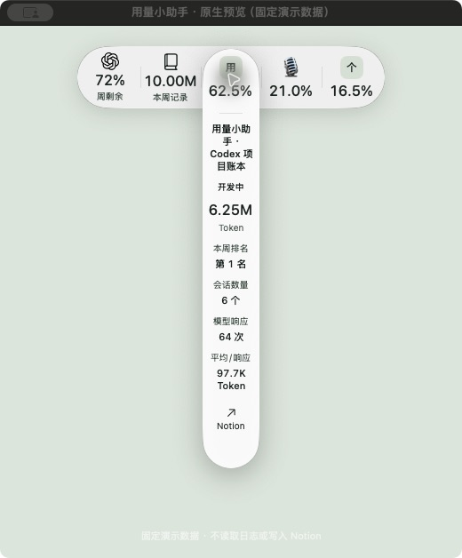

# 用量小助手 · Codex Usage Helper

**看看 Codex 的 Token 都花在哪个项目上。**

一个在本机运行的 Codex 用量扫描器和 macOS 桌面组件。根据已有会话记录统计项目、会话、模型和日期用量，再把最常用的任务放进桌面上的小胶囊。



> 图中为演示数据。项目 Token 来自本机保留的记录；官方剩余额度是另一种数据，二者不能直接换算。

## 可以做什么

- **按项目看用量**：桌面组件按 `Documents` 下一级文件夹名称归集任务；命令行扫描器还会识别工作目录和 Git 仓库。
- **桌面小胶囊**：横条直接显示项目头像或 Logo 与本周占比，展开显示完整名称，优先展示用量最高的三个任务，其余放进“其他”。
- **悬停或点击看详情**：查看 Token、本周排名、会话数、模型响应次数，以及可确认时的平均每次响应 Token。
- **三种展示方式**：顶部横条、右侧竖条、桌面小框分别开关，也可以同时开启。默认在桌面层，普通窗口可以盖住它。
- **额度详情**：通过官方 Codex app-server 的只读接口读取当前窗口剩余百分比及重置时间；保存观测后显示本周已记录累计和超额情况。
- **Notion 项目账本**：读取项目名称、头像和状态，把绑定项目的每日用量摘要写入 Notion；离线仍显示本地统计。
- **终端与导出**：按项目、会话、模型、日期汇总，并输出完整 JSON。

日志扫描和计量在本机进行。启用 Notion 后，只有绑定项目的日期、计数、关系和统计质量摘要会发送到指定工作区；原始日志不会上传。组件读取官方额度时会使用官方客户端的账户连接，但不会把会话日志、项目目录或统计报告发送给它。

## 快速开始：macOS 桌面组件

需要 **macOS 15+、Python 3.10+**，以及能提供 macOS 26 SDK 的 Swift/Xcode Command Line Tools。源码包含 Liquid Glass API，因此构建也需要对应 SDK；macOS 15 运行时使用毛玻璃回退。

在终端中克隆并运行：

```sh
git clone https://github.com/Cherrybooma/codex-usage-helper.git
cd codex-usage-helper
python3 -m venv .venv
.venv/bin/python3 -m pip install -r requirements-optional.txt
sh widget/build.sh
sh widget/run.command
```

`requirements-optional.txt` 提供 zstd 压缩日志支持和时区数据库；普通 JSONL/gzip 的扫描不需要第三方依赖。

额度功能还需要本机安装且登录官方 Codex CLI 或桌面应用；没有可用接口时，Token 扫描仍可使用，额度显示未取得或带标记的旧缓存。

启动后，在菜单栏或组件右键菜单中选择“顶部横条 / 右侧竖条 / 桌面小框”。悬停展开、点击保持，再点收起；点击其他模块切换详情，Esc 或外部点击关闭详情。在菜单栏选择退出才会停止后台刷新。

构建产物位于 `widget/build/用量小助手.app`。这是本地 ad-hoc 签名的开发应用，尚未提供可独立安装的发行包；请保留项目目录和 `.venv`，应用目前依赖其中的 Python 数据层。

项目根目录和 Notion 连接可在菜单栏的“项目与 Notion 设置…”中配置。连接凭据只保存在系统钥匙串；首次同步从本周开始，不会自动为所有文件夹创建项目。见 [Notion 说明](docs/notion.md)。

更完整的运行说明见 [桌面组件文档](widget/README.md)。

## 只使用命令行扫描器

扫描器可在安装 Python 3.10+ 的 macOS、Linux、Windows 上使用，不需要构建桌面应用。

```sh
# 最近滚动 7 天，默认按项目汇总
python3 codex_usage.py

# 分别按会话、模型、日期查看
python3 codex_usage.py --group-by session
python3 codex_usage.py --group-by model
python3 codex_usage.py --group-by day --timezone Asia/Shanghai

# 导出完整报告
python3 codex_usage.py --format json --output report.json

# 全部保留历史
python3 codex_usage.py --all-time

# 使用固定时间窗口，终点不包含在内
python3 codex_usage.py --since 2026-10-01 --until 2026-10-08 --timezone Asia/Shanghai

# 同一 Git 仓库的 worktree 分开显示
python3 codex_usage.py --separate-worktrees
```

Windows 可将 `python3` 替换为 `py -3`。优先使用 `CODEX_HOME`，否则扫描 `~/.codex/sessions` 与 `~/.codex/archived_sessions`。参数以 `python3 codex_usage.py --help` 为准。

## 怎么统计

| 数据 | 统计方法 |
| --- | --- |
| 新版日志 | 累计单次 `token_usage_record.usage`，按 `response_id` 去重；累计快照不重复相加 |
| 旧版日志 | 计算 `token_count` 累计差分，窗口之前的历史用于建立基线；结果属于估算 |
| Token 总数 | 优先采用原记录 `total_tokens`；缓存输入和推理输出是细分，不再加进总数 |
| 项目归属 | 采用请求当时的工作目录/模型上下文，识别 Git 根目录；未知目录保留分类 |
| 日期 | 使用记录内部时间，不能用文件夹日期代替 |
| 桌面“本周” | 北京时间周一 00:00 至下周一 00:00；刷新时只统计当前时刻之前 |
| 命令行默认窗口 | 最近滚动 7×24 小时，与桌面自然周不同 |

同一仓库的多个 worktree 默认合并；归档副本、重复响应、fork 继承和新旧格式混合均有去重/基线处理。不能确认的旧历史会标为估算、跳过并警告，而不会为了凑总数补算。

横条和竖条展示前三个真实任务，即使第二、第三名低于 5%；桌面小框保留“低于 5% 合并到其他”的分类。占比均以全部本机已记录 Token 为分母。

完整口径与异常处理见 [统计说明](docs/statistics.md)。

## 额度与“本周超额”

“当前已用”是官方当前窗口百分比；“本周已用”是固定自然周中已保存的观测累计，二者在提前重置后会不同。

例如重置前记录了 80%，重置后又记录了 70%，本周已记录使用约 150%，超额约 50%。只累计实际观测到的使用增量，**重置本身不会凭空增加 100%**。

采集中断、首次采集发生在周中、重置前缺少最终读数、额度容量变化等情况都会影响判断：

- 有缺口时提示“周记录不完整”。
- “未超额”表示已记录累计未超过 100%，不能证明完整账户消费未超额。
- 可确认的超额下限显示 `≥`，变化原因或容量有歧义时显示待核实。
- 超额表示相对额度的额外使用，**不代表额外收费**。

不会假设某个订阅每周固定发放多少 Token，也不会用项目 Token 占比推算项目消耗的官方额度。

## 数据与隐私

- 扫描器不联网，不直接读取 `auth.json` 或认证环境变量，不修改 Codex 会话记录。
- 报告只导出用量与归因元数据，不包含提示词、代码、回复或工具输出；报告仍可能包含私人目录和会话 ID。
- 官方额度认证由官方客户端处理，本项目只调用 `account/rateLimits/read`，保留必要额度字段。
- Notion 同步采用稳定项目身份和“项目 × 日期 × Codex × 匿名来源数据集”摘要键，重复扫描替换数值；会话哈希键只在本地用于去重。
- 本地缓存、额度历史和窗口设置位于 `widget/data/`；真实验证导出位于 `validation/`，均被 Git 忽略。
- 仓库中的 UI 预览和示意图使用演示数据，不包含作者的真实用量记录。

## 检查与测试

Python 测试使用临时模拟日志与临时 Git 仓库，不读取用户真实会话：

```sh
.venv/bin/python3 -m unittest -v test_codex_usage.py widget/test_widget_backend.py widget/test_project_store.py widget/test_notion_sync.py
```

Swift 数据与交互检查：

```sh
mkdir -p widget/build/module-cache
xcrun swiftc -parse-as-library -swift-version 5 -D WIDGET_CHECKS \
  widget/UsageWidget.swift widget/UsageStrip.swift widget/NotionSettings.swift widget/test_strip.swift \
  -o widget/build/strip-checks -framework AppKit -framework SwiftUI -framework Security \
  -module-cache-path widget/build/module-cache
widget/build/strip-checks
```

已在 macOS 15、Python 3.12、Swift 6.2.4 / macOS 26.2 SDK 上完成本机检查。具体测试结果以当前版本实际执行为准；模拟测试通过不等于其他机器的真实用量已验证。

## 目录

```text
codex_usage.py                本地日志扫描器
test_codex_usage.py           扫描器测试
widget/UsageWidget.swift      macOS 应用与桌面小框
widget/UsageStrip.swift       条形组件与交互
widget/widget_backend.py     本周归集、官方额度读取和历史估算
widget/project_store.py      稳定项目身份和项目每日事实
widget/notion_sync.py         Notion 元数据、绑定与摘要同步
widget/NotionSettings.swift   原生设置和专用钥匙串凭据
widget/test_notion_sync.py    同步、重试与幂等测试
widget/test_widget_backend.py 数据层测试
widget/test_strip.swift       Swift 数据与交互检查
widget/preview/demo.html     使用演示数据的交互预览
docs/statistics.md            详细统计口径
```

## 当前限制

只覆盖本机仍保留的记录，不能恢复删除的历史，也不会自动合并其他设备/云端任务的 Token。日志格式与官方 app-server 版本变化可能需要适配。macOS 26 原生玻璃效果尚未在该系统实机验证；窗口位置暂不持久化；现阶段以本地构建运行。
